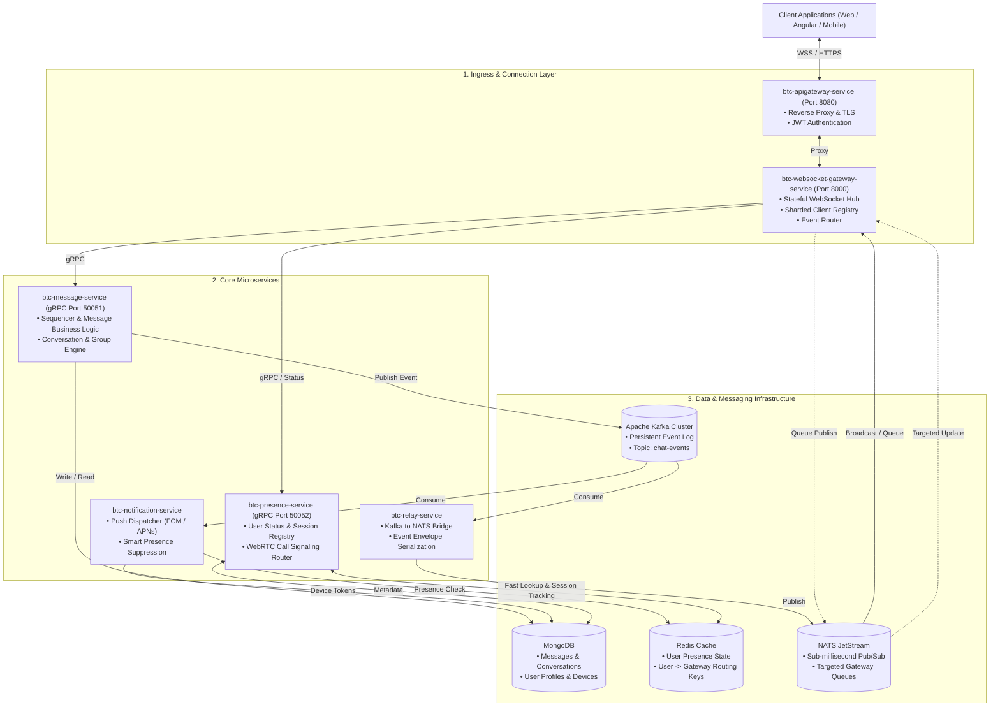
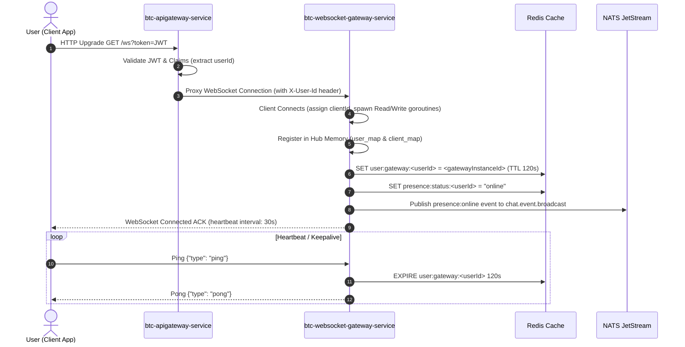
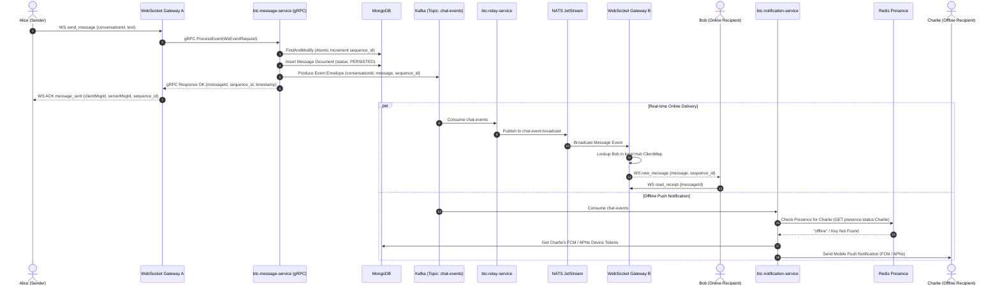
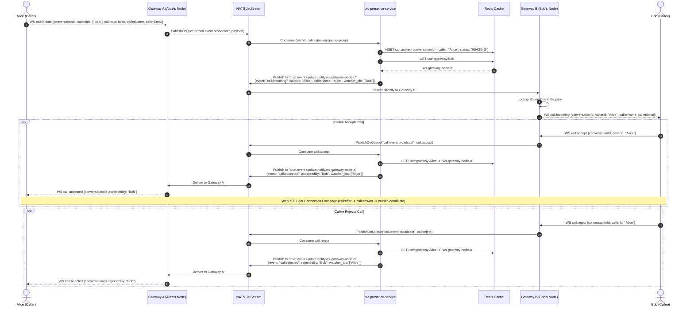

# Confeet Chat & Call Ecosystem: System Architecture & Design Specification

> **Target Audience:** Developers, System Architects, and AI / LLM Context Interpreters.  
> **Repository:** `btc-chat`  
> **Last Updated:** September 2026

---

## 1. Executive Overview

The **Confeet Chat & Call Ecosystem** is a distributed, high-throughput, low-latency communication platform providing:
1. **Real-time 1:1 and Group Instant Messaging** (with sequencing, persistence, delivery receipts, and reactions).
2. **WebRTC Audio & Video Calling / Conferencing** (targeted signaling, peer-to-peer and SFU/MCU mesh readiness, invite/join requests, call timeouts, and ring orchestration).
3. **Presence & User State Management** (online/offline status, activity heartbeats, dynamic gateway location mapping).
4. **Reliable Push Notifications** (smart delivery to offline users via FCM/APNs based on live presence state).

The platform adopts a hybrid **Event-Driven & Microservices Architecture** combining **WebSockets**, **gRPC**, **Apache Kafka**, **NATS JetStream**, **Redis**, and **MongoDB**.



---

## 2. Microservice Inventory & Responsibilities

| Service Name | Directory | Primary Role | Protocols / Interfaces | Backing Stores |
|---|---|---|---|---|
| **`btc-apigateway-service`** | `btc-apigateway-service/` | Edge reverse proxy, SSL termination, route validation, token parsing. | HTTP/1.1, WebSocket Proxy (Port 8080) | None (Stateless) |
| **`btc-websocket-gateway-service`** | `btc-websocket-gateway-service/` | Maintains persistent client WebSockets, executes sharded memory routing, dispatches inbound frames, and ingests NATS events. | WebSocket (Port 8000), gRPC Client, NATS Subscriber | In-memory Sharded Registry |
| **`btc-message-service`** | `btc-message-service/` | Chat persistence engine, per-conversation monotonic sequence generation, conversation member access checks. | gRPC Server (Port 50051), Kafka Producer | MongoDB (`chat_db`) |
| **`btc-presence-service`** | `btc-presence-service/` | User presence state tracking, heartbeat monitoring, and WebRTC call signaling route calculation. | gRPC Server (Port 50052), NATS Consumer / Publisher | Redis (`presence_db`), MongoDB |
| **`btc-relay-service`** | `btc-relay-service/` | Bridges high-durability Kafka chat event logs into real-time NATS JetStream pub/sub. | Kafka Consumer, NATS Publisher | None (Stateless Stream Bridge) |
| **`btc-notification-service`** | `btc-notification-service/` | Evaluates message recipients, checks live presence in Redis, and pushes notifications to APNs/FCM if offline. | Kafka Consumer, HTTP (Push Provider APIs) | Redis (Presence read), MongoDB (Device Tokens) |
| **`btc-grpc`** | `btc-grpc/` | Protobuf definitions (`.proto`) and compiled Go stubs for inter-service communication. | Protobuf / gRPC definitions | N/A |
| **`btc-schema-script`** | `btc-schema-script/` | Database setup scripts, MongoDB collection indexes, migrations. | Bash / Node / Mongo Shell | MongoDB schema definitions |

---

## 3. Communication & Data Topology

### 3.1 Synchronous vs. Asynchronous Communication
* **Synchronous (gRPC)**:
  * Used on the **inbound write path**: WebSocket Gateway $\xrightarrow{\text{gRPC}}$ Message Service / Presence Service.
  * Ensures immediate validation, authorization, and sequence numbering before acknowledging receipt to the sender.
* **Asynchronous (Kafka & NATS)**:
  * **Kafka**: Durable write log for chat messages and notifications (guaranteed at-least-once persistence, replayability).
  * **NATS JetStream**: High-speed fan-out and targeted push notifications from backend microservices back to the distributed WebSocket Gateway instances.

### 3.2 NATS Subject & Queue Group Conventions
* **Chat Broadcast**: `chat.event.broadcast`  
  * Used for broadcasting global/chat events across gateways.
  * Consumed by `btc-presence-service` via Queue Group `btc-presence-queue-group`.
* **Call Signaling Broadcast**: `call.event.broadcast`  
  * Used by WebSocket Gateway to dispatch WebRTC call events (`call:initiate`, `call:accept`, `call:reject`, etc.) to the Presence orchestrator.
  * Consumed by `btc-presence-service` via Queue Group `btc-call-signaling-queue-group`.
* **Targeted Gateway Dispatch**: `chat.event.update.notify.<gateway_instance_id>`  
  * Used by `btc-presence-service` to deliver targeted WebRTC signaling and presence updates **directly** to the exact Gateway instance holding the recipient's socket ($O(1)$ delivery, no global fan-out).

### 3.3 Redis Keyspace Design
* `user:gateway:<userId>` $\rightarrow$ `string` (Gateway Instance ID, e.g., `"ws-gw-pod-01"`). TTL: 120s (refreshed by socket heartbeat).
* `presence:status:<userId>` $\rightarrow$ `string` (`"online"`, `"offline"`, `"busy"`).
* `presence:heartbeat:<userId>` $\rightarrow$ `timestamp`. TTL: 60s.
* `call:active:<conversationId>` $\rightarrow$ `hash` (Call session metadata, initiator ID, participant states, start timestamp).

### 3.4 MongoDB Collections (`chat_db`)
* `messages`: Message payloads, timestamps, monotonic `sequence_id`, sender ID, conversation ID, attachments, delivery/read statuses.
* `conversations`: Conversation ID, type (`direct` / `group`), member array, admin IDs, last message snapshot, created/updated timestamps.
* `conversation_sequences`: Atomic sequence counters per conversation (`_id: conversationId`, `current_seq: int64`).
* `user_devices`: User ID, FCM/APNs push tokens, device platform (`ios`, `android`, `web`), last active timestamp.

---

## 4. End-to-End Core Workflows

### 4.1 Workflow A: Client Connection, Authentication & Presence Setup



---

### 4.2 Workflow B: Real-Time Chat Message Lifecycle



---

### 4.3 Workflow C: Targeted WebRTC Audio/Video Call Signaling

This workflow uses **Targeted NATS Dispatch** ($O(1)$ Gateway Routing) to avoid broadcasting WebRTC SDP packets and ICE candidates to all connected servers.



---

## 5. Directory Structure & Key Files

```plaintext
btc-chat/
├── btc-apigateway-service/          # Ingress API Gateway (Go)
│   ├── cmd/server/main.go           # Entry point, router & proxy handlers
│   └── internal/middleware/auth.go  # JWT extraction & validation
│
├── btc-websocket-gateway-service/   # Real-time WebSocket Gateway (Go)
│   ├── cmd/server/main.go           # Gateway init, metrics, signals
│   └── internal/
│       ├── clients/
│       │   └── client.go            # WS connection, ReadPump / WritePump goroutines
│       ├── hub/
│       │   ├── hub.go               # Sharded connection map & worker pool
│       │   ├── registry.go          # Event handler dispatcher registry
│       │   ├── nats-consumer.go     # Subscribes to broadcast & targeted gateway subjects
│       │   ├── message-grpc.go      # gRPC client to Message Service
│       │   └── handlers/
│       │       ├── handler_message.go   # Handles chat messages & receipts
│       │       ├── handler_call.go      # Handles WebRTC call signaling routing
│       │       └── handler_presence.go  # Handles user status & ping events
│       └── event/
│           ├── call_events.go       # WebRTC signaling payload definitions
│           └── event.go             # Generic WebSocket event envelopes
│
├── btc-presence-service/            # Presence & Call Signaling Service (Go)
│   ├── cmd/server/main.go           # Service init, NATS consumers start
│   └── internal/
│       ├── consumer/
│       │   ├── presence_consumer.go        # Listens on chat.event.broadcast
│       │   └── call_signaling_consumer.go  # Listens on call.event.broadcast
│       └── handlers/
│           ├── handle_presence.go          # Updates Redis status & heartbeats
│           └── handle_call_signaling.go    # Targeted recipient resolution & dispatch
│
├── btc-message-service/             # Core Chat Engine (Go)
│   ├── cmd/server/main.go           # gRPC server setup
│   └── internal/
│       ├── grpc/service.go          # ProcessEvent implementation
│       ├── repository/mongo.go      # MongoDB conversation & message queries
│       └── producer/kafka.go        # Publishes persisted messages to Kafka
│
├── btc-relay-service/               # Kafka -> NATS Bridge (Go)
│   ├── cmd/server/main.go           # Consumer group initialization
│   └── internal/relay/relay.go      # Consumes Kafka topic and forwards to NATS JetStream
│
├── btc-notification-service/        # Push Notification Engine (Go)
│   ├── cmd/server/main.go           # Push worker daemon
│   └── internal/push/dispatcher.go  # Redis presence check & FCM/APNs dispatch
│
├── btc-grpc/                        # Protocol Buffers & Generated Code
│   ├── protos/
│   │   ├── message.proto            # Chat gRPC service definitions
│   │   └── presence.proto           # Presence gRPC service definitions
│   └── gen/go/                      # Generated Go structs and interfaces
│
└── documents/                       # Architecture & Technical Documentation
    ├── CHAT_END_TO_END_FLOW.md       # In-depth chat message path
    └── SYSTEM_ARCHITECTURE_AND_WORKFLOW.md # (This File) Master Architecture Guide
```

---

## 6. Event Specification Contracts

### 6.1 Chat WebSocket Event Contract
```json
{
  "event": "send_message",
  "payload": {
    "conversation_id": "conv_67890",
    "client_msg_id": "uuid-v4-client-id",
    "text": "Hello, world!",
    "type": "text",
    "attachments": []
  }
}
```

### 6.2 WebRTC Call Initiate Contract (`call:initiate`)
```json
{
  "event": "call:initiate",
  "payload": {
    "conversation_id": "conv_67890",
    "caller_id": "USR001",
    "caller_name": "Alice Smith",
    "caller_email": "alice@confeet.com",
    "callee_ids": ["USR002"],
    "is_group": false,
    "call_type": "audio",
    "timeout": 120
  }
}
```

### 6.3 WebRTC Call Incoming Delivery Contract (`call:incoming`)
```json
{
  "event": "call:incoming",
  "payload": {
    "conversation_id": "conv_67890",
    "caller_id": "USR001",
    "caller_name": "Alice Smith",
    "caller_email": "alice@confeet.com",
    "is_group": false,
    "call_type": "audio",
    "timestamp": 1790260318000
  }
}
```

### 6.4 WebRTC SDP Negotiation Contracts (`call:offer`, `call:answer`, `call:ice-candidate`)
```json
{
  "event": "call:offer",
  "payload": {
    "conversation_id": "conv_67890",
    "caller_id": "USR001",
    "receiver_id": "USR002",
    "sdp": "v=0\r\no=- 461173... IN IP4 0.0.0.0\r\ns=-\r\nt=0 0\r\n...",
    "type": "offer"
  }
}
```

---

## 7. Architectural Guardrails & Resilience Principles

1. **Targeted Signaling & Fan-Out Elimination**:
   * Signaling events are never broadcast globally to all gateways. Instead, `btc-presence-service` looks up the recipient's gateway in Redis (`user:gateway:<userId>`) and dispatches strictly to `chat.event.update.notify.<gateway_instance_id>`.
2. **Infinite Self-Loop Prevention**:
   * All NATS consumers enforce `if msg.SourceInstance == "presence-service" { return }` on broadcast listeners to prevent an event from looping back infinitely.
3. **Queue Group Load Balancing**:
   * Background listeners subscribe with NATS Queue Groups (`btc-presence-queue-group`, `btc-call-signaling-queue-group`). If 5 replicas of `btc-presence-service` are running, each event is handled by exactly **one** instance.
4. **Lightweight Concurrency**:
   * WebSockets use Go's lightweight runtime scheduler (~2KB per goroutine). A server with 50 connected users will display ~100 parked goroutines (`runtime.gopark`), which is optimal and uses negligible memory.
5. **Stateful Gateway Isolation**:
   * The WebSocket Gateway is stateless regarding long-term storage, keeping only connection handles in memory. Any gateway crash only prompts clients to reconnect and re-register their `user:gateway:<id>` key in Redis automatically.
